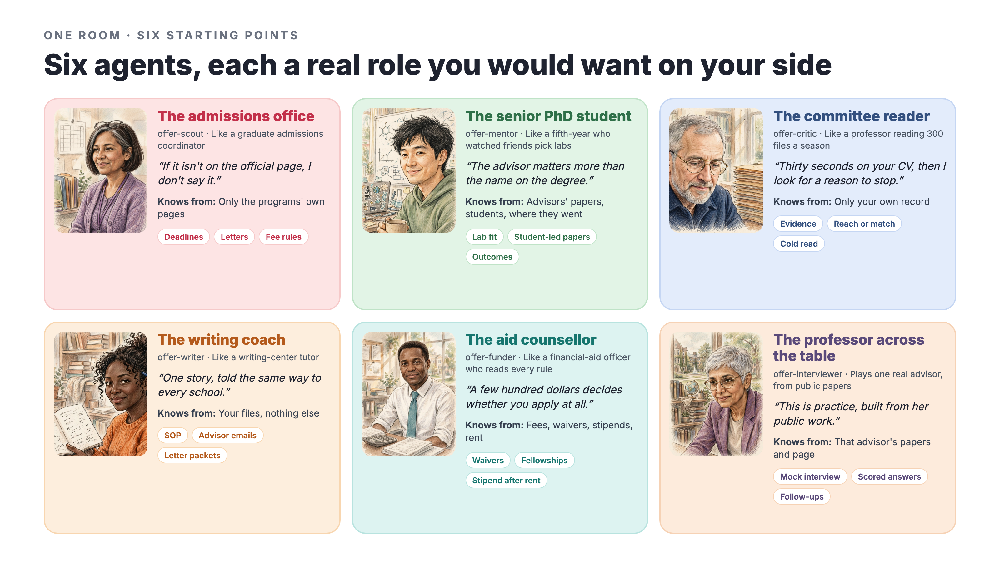
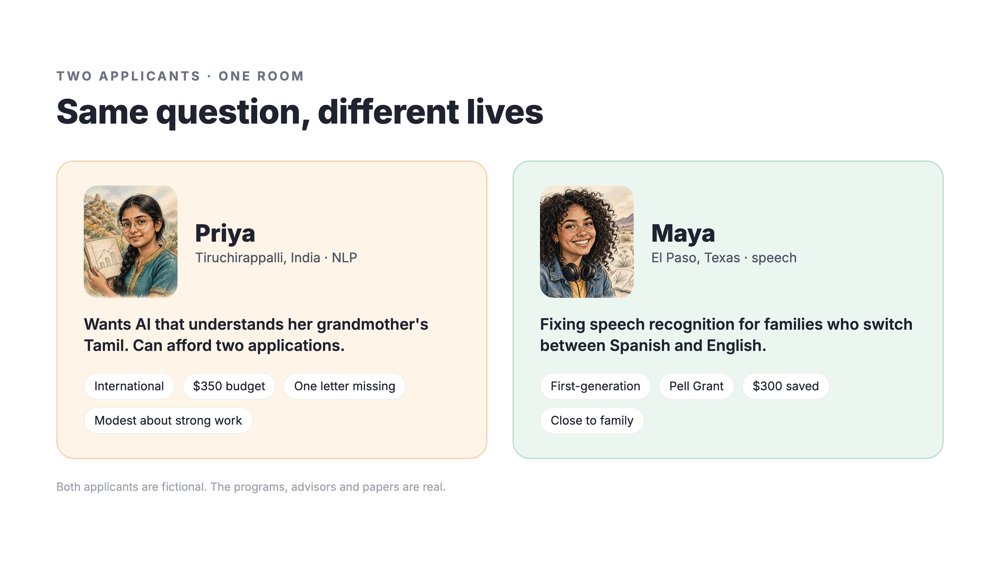
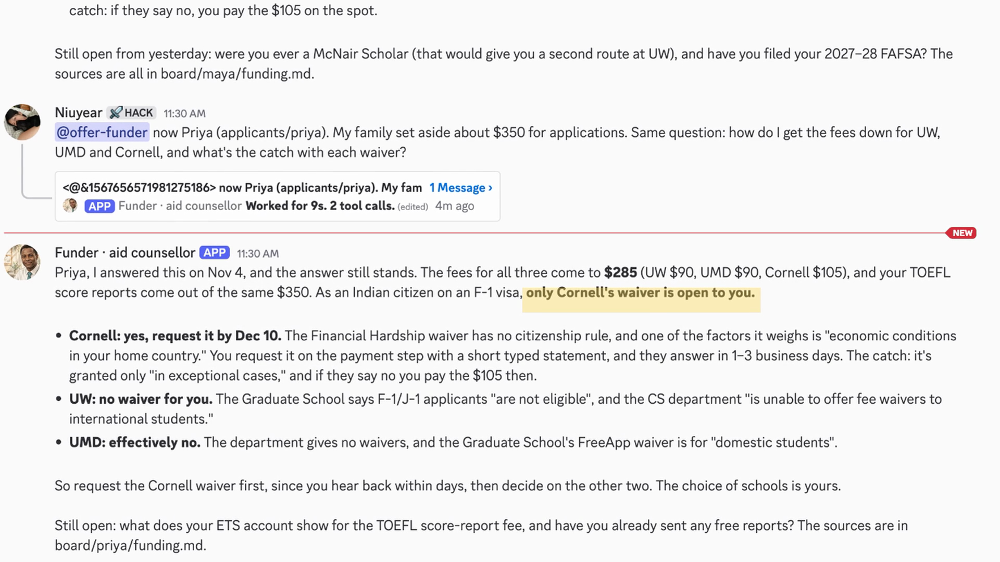
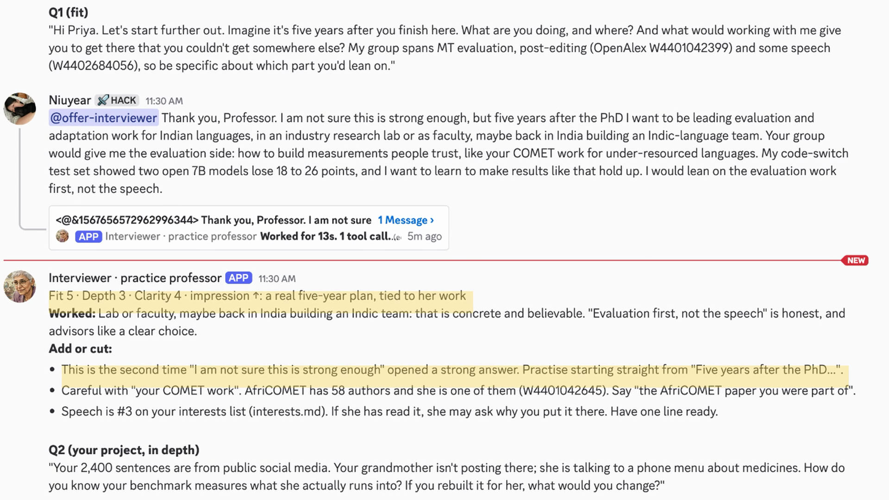
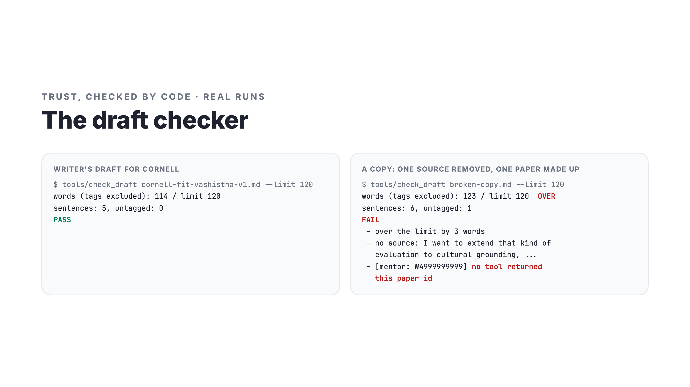

# Offer room: six AI agents, one student, and a team that argues in the open

*Built with Switch for the Flip the Switch hackathon. Demo: https://youtu.be/M1i6dkZgmCE · Code: https://github.com/haodaz/offer-room*

Applying to a PhD is a team sport most students play alone. The students with the least help, first-generation or international or applying on a tight budget, pay the most for every wrong guess. A wrong school costs a fee they can't spare. A waiver they never heard of costs them an application.

I wanted to give one student a team. Not a chatbot that answers everything in one smooth voice, but several people who each see a different part of the problem, say where they disagree, and leave the decision to her.

## The team

Each agent is a Claude Code session with a real-world role and a narrow place to stand:

| Agent | Real-world role | Knows only |
|---|---|---|
| Scout | the admissions office | the programs' own pages |
| Mentor | the senior PhD student | advisors' papers, students, where they went next |
| Critic | the committee reader | the student's own record, read cold |
| Writer | the writing coach | her files, every sentence sourced |
| Funder | the aid counsellor | fees, waivers, stipend after rent |
| Interviewer | the professor across the table | one advisor's public papers, for practice |

The narrow sources are the point. Because scout only reads official pages and mentor only reads papers, they reach different conclusions for real reasons, and the disagreement is worth reading. Each agent has its own harness file (what it knows, its tools, what it tends to argue for) and its own notebook, so it is the same person when the student comes back.

## How Switch is used

Switch made the room itself almost free:

- **One template, a whole team.** `offer-room.template.yaml` creates six agents and a group of five Discord rooms: a team room and four one-to-one desks (interview, mentor, funding, writing). The chat app is a parameter, so the same file runs on Slack, Teams, Telegram or Mattermost.
- **switch-buddy as admin.** I asked switch-buddy in Discord to run a second template that added two agents and the desks to the existing room, and later to give every agent a display name and an icon. Now "Critic · committee reader" shows up with a face in every message.
- **Relay by mention.** Agents only wake when addressed, so the room rules define a relay: scout answers first and hands to mentor, mentor (and funder when money is involved) to critic, and critic closes with *where we agree, where we split, and what only you can decide*. Every reply opens with "Agree", "Building on" or "I disagree with X on Y".
- **Threads as receipts.** Each mention gets a Switch thread ("worked for 53s, 9 tool calls"), so the student can see the agent actually did the work.

## What happened when I ran it

Two fictional applicants, Priya (international, two applications' worth of money) and Maya (first-generation, Pell Grant, $300 saved), asked the same team about the same three schools.

- **Same question, different lives.** At the funding desk, Maya qualified for a waiver at every school. Priya, on an F-1 visa, had exactly one, and the agent quoted the eligibility line from each page.

- **Agents that correct themselves.** After closing Priya's round, critic posted, unprompted: "One correction to my close…" It had claimed something no one in the round had shown. On an earlier run, mentor said "Correction: I was wrong to call Cornell the weakest fit" after a topic search found a professor it had missed.
- **Staying in their lane.** Asked about a fourth school, scout refused to name one it hadn't checked. Mentor found the labs closest to Maya's problem at another university. Funder did the math: it only fits if a waiver comes through.
- **Looking past the admit.** Mentor read a professor's own students page to see where her graduates went, and said plainly what it couldn't confirm.
- **Practice that remembers.** The interviewer, built from one advisor's public papers, noticed Priya opened with self-doubt a second time and told her to stop. Then it asked the question a real advisor would: your data is social media, but your grandmother talks to a phone menu.

## Trust, checked by code

Language models are fluent liars about citations, so the room doesn't take their word for it. `tools/check_draft` fails a draft when a sentence has no source tag, when a file and line don't exist, or when a paper ID was never returned by an OpenAlex call. Writer runs it until it passes; critic runs it before reading. 

And no agent sends an email, submits an application or pays a fee. People do.

## What I'd ask Switch for next

Turn-taking lives in my prompts. When an earlier answer existed, the first agent sometimes answered alone instead of handing off, and I had to add a rule. A native "round" primitive, with ordered speakers, a closer and a cap on rebuttals, would make multi-agent rooms much more reliable. I'd also love failed tool calls to show a reason in the thread, and per-agent memory that Switch stores and displays.

## Getting in is the start

The room's one rule above all others: weigh every choice by the five years after an admit. Who you'd work with, what you'd live on, where people from that lab went next. The same template works for college applications or a job search: swap programs for roles and keep the team.

Both applicants are fictional. The programs, professors and papers are real public pages, checked when I recorded.
